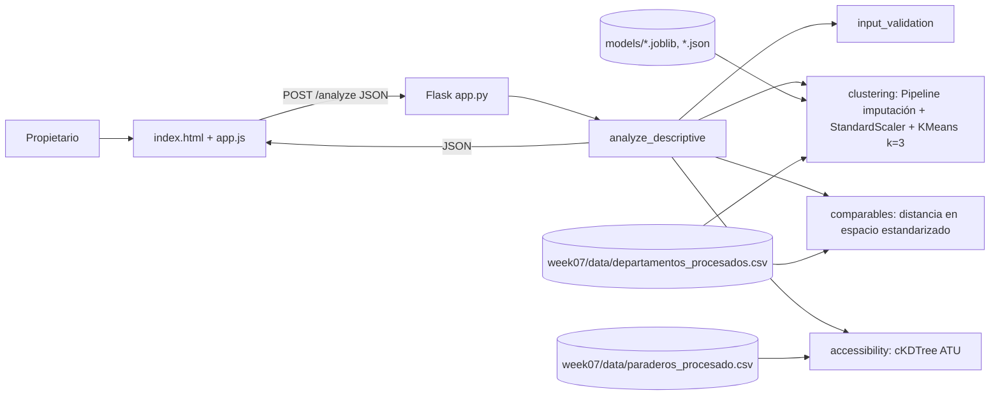

# Prototype Report — DepaRent Week 10

## 1. Objetivo del prototipo

Demostrar el flujo descriptivo de DepaRent de extremo a extremo: un propietario ingresa las características de su departamento en una interfaz web y obtiene su perfil competitivo, los cinco anuncios más similares del mercado y su accesibilidad al transporte público.

El prototipo está orientado exclusivamente al **propietario del inmueble**: la experiencia del usuario que busca alquilar no forma parte de Week 10. El alcance se limitó deliberadamente a la capa descriptiva (RF1 y RF2) para entregar un flujo técnicamente consistente y reproducible. **No incluye predicción de precio, BCRP, forecasting, escenarios ni simulador de mejoras.**

## 2. Alcance funcional

| Funcionalidad | Estado | Ubicación |
|---|---|---|
| Formulario del propietario (distrito, área, dormitorios, baños, antigüedad, mantenimiento, 13 amenidades, coordenadas) | Implementado | `code/templates/index.html`, `code/static/` |
| Validación de entrada (frontend + backend) | Implementado | `code/src/input_validation.py` |
| RF1 Perfil competitivo | Implementado | `code/src/clustering.py`, `models/` |
| RF1 Propiedades comparables | Implementado | `code/src/comparables.py` |
| RF2 Perfil de accesibilidad ATU | Implementado | `code/src/accessibility.py` |
| API Flask (`/`, `/health`, `/analyze`) | Implementado | `code/app.py` |
| Despliegue público | Pendiente | `deployed_url.txt` |

### RF1 Perfil competitivo
Asigna la propiedad a uno de 3 segmentos descriptivos y muestra el perfil estadístico del segmento.

### RF1 Propiedades comparables
Devuelve los 5 anuncios reales más similares del mismo segmento, con prioridad al mismo distrito. Su precio publicado se muestra solo como referencia.

### RF2 Perfil de accesibilidad
Calcula, a partir de las coordenadas, la distancia al paradero ATU más cercano, el número de paraderos a 300, 500 y 1,000 m, y la distancia a la troncal BRT y al corredor más cercanos.

## 3. Arquitectura

El modelo, el dataset de referencia de comparables y el índice ATU se cargan una sola vez al iniciar la aplicación. Ante errores de validación la API responde HTTP 400 (`validation_error` con la lista de problemas); ante errores inesperados, HTTP 500 con un mensaje genérico, registrando el detalle solo en el log del servidor.

## 4. Datos utilizados

| Archivo | Uso | Registros |
|---|---|---|
| `deliveries/week07/data/departamentos_procesados.csv` | Entrenamiento del clustering y universo de comparables (anuncios con coordenadas validadas en Lima/Callao) | 3,128 |
| `deliveries/week07/data/paraderos_procesado.csv` | Índice de accesibilidad ATU (corte 2021-05-24) | 3,233 |

Ambos son salidas verificadas del notebook canónico `deliveries/week07/code/EDA_week07.ipynb`: regenerarlo produce archivos idénticos. El SHA-256 del dataset de departamentos queda registrado en `models/clustering_metadata.json` y se verifica al cargar el modelo.

No se usó `departamentos_sin_geo_para_clustering.csv`, la base del K-Means de Week 7, porque incluye 135 anuncios de otras ciudades y 308 sin coordenadas.

## 5. Perfil competitivo

**Variables (18):** `area_total`, `dormitorios`, `banos`, `antiguedad`, `mantenimiento` y 13 amenidades (ascensor, balcón, terraza, piscina, gimnasio, depósito, vista al mar, parrilla, áreas verdes, seguridad 24/7, coworking, juegos infantiles, pet friendly).

**Exclusión del precio.** El K-Means de Week 7 usaba `precio_m2_real`, lo que crea una dependencia circular: el propietario aún no conoce su precio. Se excluyen `precio_soles`, `precio_m2_real`, `precio` y `precio_m2`. También se excluyen:
- `cochera`, que es constante;
- `estacionamientos`, con nulos ambiguos;
- `medios_banos` y `piso`, con muchos nulos;
- las banderas de imputación;
- BCRP y ATU.

**Preprocesamiento.** Los parámetros se aprenden en entrenamiento y se persisten en el pipeline:
- Los valores fuera de rango pasan a NaN: 1 en baños, 1 en antigüedad y 34 en mantenimiento.
- La antigüedad y el mantenimiento faltantes se imputan con la mediana del grupo distrital, y los baños faltantes con la moda según dormitorios.
- Las variables se escalan con `StandardScaler`.

**Evaluación k = 2…6** (K-Means, `n_init=10`, `random_state=42`). La estabilidad se midió con el ARI entre 5 semillas alternativas y entre 10 submuestras del 80%.

| k | silhouette | tamaños (%) | ARI semillas (mín.) | ARI submuestras (mín. / media) |
|---|---|---|---|---|
| 2 | 0.1674 | 37.7 / 62.3 | 0.995 | 0.968 / 0.982 |
| **3** | **0.1676** | **15.0 / 48.8 / 36.3** | **1.000** | **0.988 / 0.991** |
| 4 | 0.1751 | 48.0 / 28.8 / 8.7 / 14.4 | 0.987 | 0.981 / 0.986 |
| 5 | 0.1003 | 28.5 / 9.8 / 25.5 / 8.6 / 27.7 | 0.993 | 0.920 / 0.969 |
| 6 | 0.1034 | 7.8 / 8.4 / 25.0 / 23.9 / 8.1 / 26.7 | 0.953 | 0.715 / 0.821 |

**Justificación de k = 3.** k=3 fue seleccionado como compromiso entre estabilidad, interpretabilidad y utilidad para el producto. Aunque k=4 presenta un silhouette ligeramente mayor (0.1751 frente a 0.1676), incorpora un cluster pequeño fuertemente dominado por la amenidad `juegos_infantiles`, mientras que k=3 presenta mayor estabilidad y perfiles más generales para el objetivo descriptivo del prototipo.

**Silhouette y estabilidad.** El modelo final tiene un silhouette de 0.1676 y ARI = 1.000 entre semillas. La estructura global es débil (silhouette < 0.25): los perfiles son una **segmentación descriptiva exploratoria**, no grupos naturales del mercado.

**Interpretación (medianas observadas).** Los nombres están en `models/cluster_names.json`, separados del `cluster_id`.

| id | Perfil | n (%) | Área | Dorm. | Baños | Antig. | Mant. | Rasgo característico |
|---|---|---|---|---|---|---|---|---|
| 0 | Amplio con mantenimiento alto | 468 (15.0%) | 180 m² | 3 | 3 | 10 | S/ 650 | ascensor 59.4%, terraza 57.5%, depósito 37.2% |
| 1 | Tamaño medio con pocas amenidades | 1,526 (48.8%) | 75 m² | 2 | 2 | 10 | S/ 250 | menor prevalencia en las 13 amenidades |
| 2 | Compacto y reciente con amenidades de condominio | 1,134 (36.3%) | 60 m² | 2 | 2 | 2 | S/ 250 | parrilla 86.1%, gimnasio 82.5%, piscina 65.5% |

**Limitaciones.** La segmentación es débil y las amenidades provienen de palabras clave. Además, la imputación distrital de antigüedad y mantenimiento influye en la asignación de cluster.

## 6. Propiedades comparables

- **Metodología:** distancia euclidiana en el mismo espacio estandarizado de 18 variables del clustering, entre la propiedad consultada y los anuncios de su mismo cluster.
- **Prioridad distrital:** si existen al menos 5 candidatos del mismo cluster en el mismo distrito, los comparables se eligen solo entre ellos.
- **Fallback:** si no, se incluyen todos los del mismo distrito y se completa con los más cercanos del mismo cluster en otros distritos. La interfaz los marca como "otro distrito" y explica el criterio.
- **Exclusión del precio:** el precio no interviene en la similitud. Un test baraja los precios del dataset y verifica que los comparables no cambian. En la interfaz el precio aparece como "Precio publicado", solo como referencia descriptiva.
- **Limitación:** la similitud utiliza actualmente 18 dimensiones, de las cuales 13 corresponden a amenidades binarias. Por ello, las amenidades pueden tener un peso importante en la selección de comparables. La ponderación de características será objeto de evaluación posterior.

## 7. Accesibilidad ATU

- **Metodología:** la de Week 7 (In[17]), refactorizada como componente reutilizable. Se usa una proyección equirectangular centrada en lat −12.05 y un `cKDTree` sobre los 3,233 paraderos, con árboles separados para Troncal y Corredor. El índice se construye una vez.
- **Validación de coordenadas:** deben ser numéricas, finitas y estar dentro de Lima/Callao (lat [−12.35, −11.75], lon [−77.20, −76.80]).
- **Indicadores:** distancia al paradero más cercano, su tipo y nombre; paraderos a 300, 500 y 1,000 m; distancia a la troncal BRT y al corredor más cercanos.
- **Lo que no se calcula:** tiempos, frecuencias ni puntajes.
- **Verificación:** recalcular los indicadores para los 3,128 anuncios reproduce exactamente las columnas de Week 7.

## 8. Flujo del prototipo

1. El propietario completa el formulario. El distrito se elige de un selector generado desde el modelo (40 distritos) y las coordenadas se ingresan a mano, de forma temporal.
2. Pulsa **Analizar inmueble**. El navegador hace una validación HTML básica y envía JSON a `POST /analyze`.
3. El backend valida todo de nuevo y llama a `analyze_descriptive()`.
4. La interfaz muestra:
   1. el perfil competitivo, con estadísticas del segmento;
   2. la tabla **Comparables de mercado**: 5 anuncios históricos similares, con "No disponible" en los datos faltantes y el precio rotulado como "Precio publicado". Los enlaces a los anuncios no se muestran porque la publicación original puede haber finalizado después de la captura; la URL se conserva en la respuesta JSON solo por trazabilidad y RF1 no depende de que siga activa;
   3. los indicadores ATU;
   4. las notas sobre valores imputados o comparables de otros distritos.
5. Si la entrada es inválida, se muestran los errores devueltos por el backend.

Los ejemplos A, B y C de la interfaz (uno por cluster) rellenan solo el formulario, con valores derivados de anuncios reales. No contienen resultados precargados.

## 9. Pruebas

**66 tests con pytest, todos aprobados** (`code/tests/`):

| Archivo | Tests | Qué valida |
|---|---|---|
| `test_clustering.py` | 18 | Carga del modelo y metadata; ausencia de precio y de `cochera` en las variables; salida de `predict_cluster`; que reproduce las etiquetas de entrenamiento; que la imputación usa parámetros persistidos sin recalcularlos; normalización de distritos; errores explícitos ante entradas inválidas |
| `test_comparables.py` | 10 | 5 resultados; exclusión de la propia propiedad; mismo cluster; prioridad distrital; fallback; distancias finitas y ordenadas; que cambiar los precios no cambia los comparables |
| `test_accessibility.py` | 10 | Indicadores esperados; índice construido una vez; paridad exacta con Week 7; coordenadas inválidas |
| `test_descriptive_service.py` | 7 | Respuesta JSON-serializable; advertencias de imputación; casos reales; errores agregados de RF1 y RF2 |
| `test_app.py` | 21 | GET `/`, `/health` y estáticos; POST `/analyze` válido (un caso por cluster); HTTP 400 ante datos, distrito o coordenadas inválidos; HTTP 500 genérico sin stack trace; ausencia de campos predictivos; precios solo como dato observado; Estimator antiguo eliminado; debug no fijado en el código |

## 10. Limitaciones conocidas

- Los datos provienen de anuncios (precios de oferta), no de transacciones cerradas.
- Corresponden a una única captura del mercado (14-sep-2026). Los comparables son anuncios observados en esa fecha, y su publicación original puede haber finalizado después.
- El inventario ATU es de mayo de 2021.
- El clustering es una segmentación descriptiva exploratoria y débil, no una clasificación verdadera.
- Los comparables dependen de la cobertura del dataset; solo se aceptan los 40 distritos presentes.
- Similitud estadística no implica equivalencia inmobiliaria. Pueden existir anuncios duplicados entre portales.
- Las amenidades provienen de palabras clave: un 0 significa "no mencionado".
- La ubicación se ingresa como coordenadas manuales y no se valida contra el distrito.
- No existe todavía predicción de precio, forecasting ni recomendación prescriptiva.
- Se usa el servidor de desarrollo de Flask; no hay despliegue público.

## 11. Desafíos técnicos

- **Dependencia circular del clustering de Week 7:** usaba `precio_m2_real`. Se reentrenó sin variables de precio y se reevaluó k.
- **Imputación sin fugas en inferencia:** las medianas y modas se aprenden en entrenamiento y se persisten en un transformador propio dentro del `Pipeline`.
- **Reproducibilidad:** el Python global del equipo tenía versiones incompatibles (scikit-learn 1.9.1). Los artefactos se generaron en un entorno limpio con versiones fijadas, y el dataset se verifica por SHA-256.
- **Datos de entrenamiento inadecuados para el producto:** el dataset del K-Means anterior incluía anuncios fuera de Lima.
- **Valores implausibles en datos de texto** (antigüedad 402, 25 baños): se tratan como faltantes con los mismos rangos que valida la entrada.
- **Placeholder engañoso:** el estimador por mediana distrital devolvía resultados para cualquier distrito. Se eliminó del flujo y del código.

## 12. Trabajo pendiente hacia Week 12

1. Modelo de precio (HistGradientBoosting): serialización, contrato de inferencia, tuning e intervalos.
2. Tendencia distrital con SARIMA, ajustado y validado temporalmente.
3. Motor de escenarios de precio y simulador de mejoras.
4. Evaluación de la ponderación de características en comparables y de la utilidad de los perfiles con usuarios.
5. Ubicación por dirección o mapa en lugar de coordenadas manuales.
6. Caso de estudio realista, capturas o video de demostración y despliegue.
