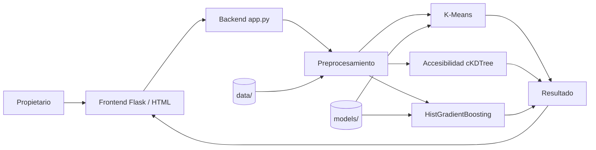

# Prototype Report — DepaRent (Semana 10)

## 1. Resumen
_2–3 párrafos: qué demuestra el prototipo, con qué datos y qué flujo principal cubre._

## 2. Funcionalidades implementadas
_Solo lo que realmente funciona hoy._

| Funcionalidad | Estado | Ubicación |
|---|---|---|
| Entrada de características del inmueble | ☐ | `code/app.py`, `templates/` |
| Preprocesamiento | ☐ | |
| Perfil competitivo (K-Means) | ☐ | |
| Accesibilidad (ATU) | ☐ | |
| Precio esperado (HistGradientBoosting) | ☐ | `models/` |
| Visualización de resultados | ☐ | |

## 3. Arquitectura del sistema

_Ajustar el diagrama a lo realmente implementado._

## 4. Resultados y ejemplos de uso
_Capturas de `screenshots/` y un ejemplo de entrada → salida._

## 5. Limitaciones conocidas
- Los precios son de oferta (asking price), no de cierre.
- Captura única de datos (14-sep-2026).
- Inventario de paraderos ATU de mayo de 2021.
- BCRP cubre 12 distritos; el 16.3% de los departamentos usa el promedio general.
- Clustering débil (silhouette 0.1776).
- _Agregar las propias del prototipo._

## 6. Desafíos técnicos
_Ejemplos: ambigüedad de `estacionamientos`, integración de ATU, serialización de modelos, integración backend–modelos._

## 7. Trabajo pendiente (hacia la Semana 12)
1. SARIMA ajustado y validado.
2. Motor de escenarios de precio y simulador de mejoras.
3. Evaluación con baselines y evidencia de pruebas.
4. Caso de estudio realista.
5. Despliegue.
