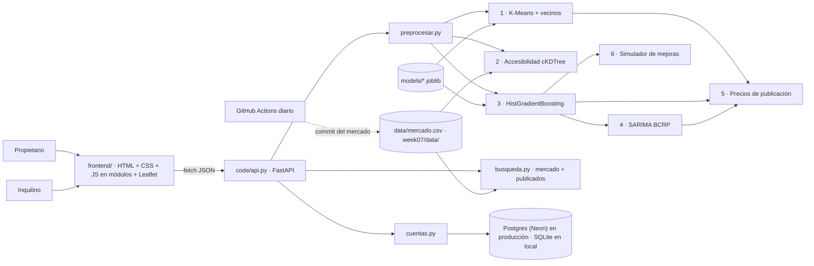

# Prototype Report — DepaRent (Semana 10)

Prototipo desplegado: **https://deparent.onrender.com** · Código: `deliveries/week10/` · Fecha de este reporte: 25-oct-2026.

## 1. Resumen
DepaRent responde la pregunta que se hace un propietario de Lima antes de publicar su departamento: **¿a cuánto lo
alquilo?** El propietario describe el departamento (distrito, área, dormitorios, baños, estacionamientos, antigüedad,
mantenimiento, amenidades y ubicación) y recibe un precio esperado con su rango, los anuncios más parecidos, la
accesibilidad a transporte, la tendencia del distrito y tres precios de publicación. Puede guardar sus
departamentos, publicarlos al precio que elija y recibir mensajes de inquilinos interesados.

Del otro lado, un inquilino busca entre los anuncios del mercado y los publicados en DepaRent, con filtros por
distrito, presupuesto, tamaño, amenidades y cercanía a paraderos, y ve en cada resultado si el precio pedido está
por debajo, en línea o por encima de lo que estima el modelo.

El prototipo trabaja con datos reales: 3,128 anuncios de Adondevivir y Urbania capturados el 14-sep-2026 (entrenamiento),
un mercado de 3,055 anuncios únicos capturado el 23-oct-2026 (lo que ve la app), los paraderos de la ATU y 13 series
trimestrales de precios del BCRP. El flujo principal completo (describir → analizar → guardar → publicar → ser
encontrado → recibir un mensaje) funciona en la versión publicada.

## 2. Funcionalidades implementadas
Todo lo listado funciona hoy en la versión desplegada; las capturas están en `screenshots/`.

| Funcionalidad | Estado | Ubicación | Captura |
|---|:-:|---|---|
| Página de inicio con estimador en vivo, carta de alquileres y equipo | ☑ | `frontend/js/inicio.js` | `01`, `14` |
| Registro, inicio de sesión y cierre de sesión de propietarios | ☑ | `code/cuentas.py`, `frontend/js/vistas.js` | `05` |
| Agregar, editar y eliminar departamentos, con ubicación elegida en un mapa | ☑ | `frontend/js/formulario.js` | `06`, `07`, `13` |
| Preprocesamiento (mismas reglas que la Semana 7) | ☑ | `code/preprocesar.py` | — |
| 1 · Perfil competitivo (K-Means, k=4) y 8 comparables | ☑ | `code/perfil_competitivo.py` | `09` |
| 2 · Accesibilidad a paraderos ATU (cKDTree) y mapa | ☑ | `code/accesibilidad.py` | `10` |
| 3 · Precio esperado (HistGradientBoosting) con rango al 90 % | ☑ | `code/modelo.py`, `models/modelo_docente.joblib` | `08` |
| 4 · Tendencia distrital (SARIMA sobre el BCRP) | ☑ | `code/tendencia.py` | `11` |
| 5 · Tres precios de publicación (competitivo, equilibrado, renta superior) | ☑ | `code/escenarios_precio.py` | `08` |
| 6 · Simulador de mejoras y exploración del área | ☑ | `code/escenarios.py`, `code/laboratorio_area.py` | `12` |
| Publicar y retirar un departamento | ☑ | `code/api.py` | `18` |
| Búsqueda para inquilinos con valoración del precio | ☑ | `code/busqueda.py` | `02`, `03`, `15` |
| Ficha de anuncio con comparables y enlace al original | ☑ | `frontend/js/anuncio.js` | `17`, `20` |
| «Me interesa»: el mensaje llega al propietario | ☑ | `code/cuentas.py` | `18`, `19` |
| Prueba sin cuenta con tres casos de ejemplo | ☑ | `#/probar` | `04` |
| Validación temporal con el mercado de octubre | ☑ | `code/validar_octubre.py`, `resultados/validacion_octubre/` | — |
| Despliegue en Render con base de datos persistente (Postgres en Neon) | ☑ | `render.yaml`, `code/cuentas.py` | — |
| Actualización diaria del mercado con GitHub Actions | ◐ | `.github/workflows/actualizar-mercado.yml` | ver §5 |

## 3. Arquitectura del sistema

- **Un solo servicio.** En Render, la API FastAPI sirve también el frontend estático; no hay servidor aparte.
- **Modelos cargados una vez** al arrancar; el modelo 3 es la versión del profesor y la app verifica sus hashes.
- **Cuentas.** Contraseñas con PBKDF2-SHA256 y sal propia; tokens de sesión guardados solo como hash, con
  vencimiento de 7 días. Con `DATABASE_URL` se usa Postgres (Neon, gratuito y persistente); sin ella, SQLite local.
- **Privacidad.** Ninguna pantalla muestra dirección, coordenadas exactas ni descripción de los anuncios de mercado;
  la ficha solo enlaza al anuncio original. Al inquilino se le muestra el nombre de pila del propietario, no su correo.

## 4. Resultados y ejemplos de uso
**Métricas del modelo de precio (prueba de septiembre, 629 anuncios, sin ajuste de hiperparámetros):**

| Modelo | MAE (S/) | MAPE | R² |
|---|--:|--:|--:|
| Mediana global (línea base) | 1,216 | 37.8 % | −0.04 |
| Mediana del distrito (línea base) | 993 | 26.6 % | 0.13 |
| **HistGradientBoosting** | **553** | **18.8 %** | **0.76** |

El rango al 90 % (radio de S/ 1,357 calibrado en 500 anuncios aparte) cubrió el 92.2 % de la prueba.

**Validación temporal.** El mismo modelo congelado, sin reentrenar, sobre 1,712 anuncios nuevos de octubre:
MAE S/ 512 (IC 95 %: 476–551), MAPE 16.4 %, R² 0.79. El modelo no se degradó en el mes siguiente.

**Otros componentes.** K-Means k=4, silhouette 0.21 y estable entre semillas (ARI 1.0). SARIMA supera al naive
estacional en 10 de 13 series del BCRP en los últimos 4 trimestres reservados.

**Ejercicio del profesor (`code/EJERCICIO_FINAL.py`), distrito Lince:**

| Distrito | n (prueba) | MAE calculado | n en la app | MAE en la app |
|---|--:|--:|--:|--:|
| Lince | 25 | S/ 284.90 | 25 | S/ 284.90 |

Coincide con la aplicación. Error individual: mediana S/ 200.45, mínimo S/ 10.49, máximo S/ 895.47. En Lince el
modelo se equivoca en promedio la mitad que en el conjunto de prueba (S/ 285 frente a S/ 553). El MAE es un promedio
de anuncios de septiembre: no es el error garantizado para otra vivienda ni para meses posteriores.

**Ejemplo de entrada → salida** (API desplegada, `POST /api/estimar`):
Miraflores, 80 m², 2 dormitorios, 2 baños, 1 estacionamiento → precio esperado **S/ 3,592**, rango S/ 2,235–4,949,
referencia distrital S/ 3,500, con 457 anuncios de entrenamiento en el distrito.

## 5. Limitaciones conocidas
- **Precios de oferta**, no de cierre: el modelo aprende lo que piden los propietarios, no lo que se termina pagando.
- **Rango amplio.** El radio del intervalo es global (±S/ 1,357): demasiado ancho para departamentos baratos y
  ajustado para los de lujo.
- **Distritos con pocos datos.** Con menos de 20 anuncios de prueba (por ejemplo, Ate con 3) el error no es fiable;
  la app lo advierte.
- **Paraderos ATU de mayo de 2021**; la red actual puede diferir.
- **BCRP** no cubre todos los distritos: el 16.3 % de los departamentos usa la serie general.
- **Clustering débil** (silhouette 0.21): los perfiles orientan, no separan mercados.
- **Actualización diaria bloqueada.** Desde el 25-oct los portales responden 403 a los servidores de GitHub. La tarea
  falla sin publicar nada y la app sigue con el mercado del 23-oct. El respaldo es la tarea programada local
  (`scraper/programar_tarea.ps1`) más `git push`.
- **Plan gratuito de Render.** El servicio se duerme tras 15 minutos sin visitas; la primera carga tarda 30–60 s.
- **Prototipo académico.** No hay recuperación de contraseña, verificación de correo ni moderación de mensajes.

## 6. Desafíos técnicos
- **Duplicados entre portales.** El mismo departamento aparece en Adondevivir y Urbania con otro id; se agruparon
  posibles inmuebles (3,013 grupos) para que ninguno quede a la vez en entrenamiento y en prueba.
- **Datos ambiguos o fuera de rango** (por ejemplo, `estacionamientos` o mantenimientos imposibles): se tratan como
  no informados y el modelo usa la mediana, en vez de descartar el anuncio.
- **Integrar la ATU** con miles de anuncios: búsqueda espacial con `cKDTree` en metros, no en grados.
- **Modelos serializados reproducibles**: versiones exactas de dependencias y verificación de hashes al cargar.
- **Persistencia en un servicio gratuito**: el disco de Render se borra en cada despliegue; se pasó a Postgres
  en Neon sin cambiar la API, manteniendo SQLite para el desarrollo local.
- **Validar sin hacer trampa**: en octubre se excluyeron los anuncios que ya estaban en septiembre (1,077 por id y
  1,387 posibles duplicados) antes de medir el error.

## 7. Trabajo pendiente (hacia la Semana 12)
1. Informe de evaluación (`EvaluationReport.md`): estrategia, métricas y comparación con las líneas base, con el
   análisis de error por distrito y por rango de precio.
2. Caso de estudio realista de un propietario y uno de un inquilino, recorridos en la app publicada.
3. Intervalo con radio dependiente del precio (por ejemplo, por cuantiles), para que el rango sea útil en los extremos.
4. Resolver la actualización del mercado: ejecutar la descarga desde la tarea local y publicar con `git push`, o
   reducir la frecuencia.
5. Observaciones de uso con 3–5 personas (propietarios e inquilinos) y ajustes de interfaz.
6. Plan de tareas y responsables para las tres semanas finales.
